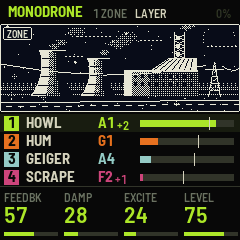

# MONODRONE

A drone instrument for the M-VAVE FM-1. Four layers of held chords from one of twelve engines run into dirt, filter, tape delay and reverb. There is no sequencer. Set things running, bend them live, move between sixteen scenes, each with its own animated 1-bit place. Twelve punch effects on the keys, eight macros.



- **Install:** the [web installer](https://monoeater.github.io/FM-1_Monodrone/install/) (Chrome or Edge, FM-1 over
  USB; it appears with the first release), or download a package from [Releases](https://github.com/monoeater/FM-1_Monodrone/releases) and run
  `python3 base/tools/fm1_install.py monodrone-X.Y.fwsc`. To go back to stock, hold OCT− while switching on and
  install M-VAVE's firmware.
- **Manual:** [monoeater.github.io/FM-1_Monodrone/manual](https://monoeater.github.io/FM-1_Monodrone/manual/), an
  interactive panel with every control, page, macro, punch, engine and scene (source in `docs/manual/`). As PDFs, 11
  landscape A4 pages: [screen](docs/MONODRONE-manual.pdf) (dark) and [print](docs/MONODRONE-manual-print.pdf) (light).
- **Try it:** the [browser emulator](https://monoeater.github.io/FM-1_Monodrone/emu/).

Firmware identity: `FM-1_77` followed by the version (1.0 is `FM-1_77010000`).

Consider supporting more development [here](https://ko-fi.com/michael_monoeater).

## Building

MONODRONE is an app on [fm1-base](https://github.com/charlesvestal/fm1-base) (in `base/`, a submodule, with
felucca-bsp in `base/bsp/`).

```sh
git clone --recursive https://github.com/monoeater/FM-1_Monodrone
cd FM-1_Monodrone
git -C base apply ../tools/base_local.patch   # font_sub: the font draws ^ as µ (scene 13, µSIEVERT)
./build.sh --host          # the host simulator: app/build/host/monodrone_host
sh tests/run_tests.sh      # its scripted tests (app/tests/)
./build.sh                 # the firmware: app/build/monodrone.fwsc (JieLi toolchain: base/tools/get_toolchain.sh,
                           # and AC79_SDK pointing at a JieLi AC79 SDK checkout)
```

Releases are built and attested on GitHub by the shared FM-1 builder (`.github/workflows/release.yml`): push a tag
`vX.Y` and the workflow builds, tests, attests and publishes the release, then the site on GitHub Pages.

- `app/` the firmware: `app.c` (controls, pages, scenes, screen), `drone_dsp.c` (the sound), `land.h` (the places)
- `app/tests/` scripted tests for the host simulator
- `tools/` offline renderers and the stress test; `art/frames/` every place's frames to edit
- `docs/manual/` the manual; `NOTES.md` the design notes and the log of every version

## Licence

MPL-2.0 (see `LICENSE`). Built on fm1-base and felucca-bsp, from Felucca by Leo Kuroshita (Hügelton Instruments).
Fonts: Barlow (SIL OFL 1.1). M-VAVE and FM-1 are trademarks of their owners; MONODRONE is not affiliated with M-VAVE.
