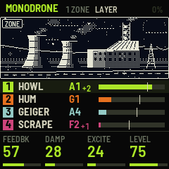

# MONODRONE

MONODRONE turns the M-VAVE FM-1 into a drone instrument. Four layers, each a held chord of up to four voices on one
of twelve engines (howls, dead choirs, Geiger clicks, shortwave static, transformer hum, chaos), run into one chain of
dirt, filter, tape delay and reverb. There is no sequencer: you set things running, bend them live and move between
sixteen scenes, each with its own animated 1-bit place. Twelve punch effects sit on the keys and eight macros move
many settings at once.

This is version {{VERSION}}. You install it at your own risk, and the installer can put M-VAVE's own firmware back.

- [Try it in the browser](emu/). Play it right here, with sound. It runs the same code as the FM-1.
- [Install](install/) it from Chrome or Edge, with the FM-1 connected by USB.
- The [Manual](manual/) shows every control on a panel you can click, every page, macro, punch, engine and scene.
- [Download {{PKG}}](firmware/{{PKG}}) for the command-line installer: `python3 fm1_install.py {{PKG}}`.
- The [Source](https://github.com/monoeater/FM-1_Monodrone) is under MPL-2.0. It's built on fm1-base and
  felucca-bsp, which come from Felucca by Leo Kuroshita, Hügelton Instruments.

M-VAVE and FM-1 are trademarks of their owners. MONODRONE is not affiliated with M-VAVE.
